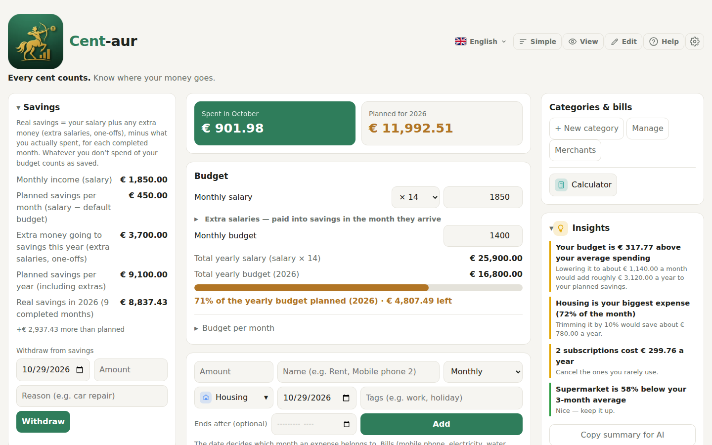
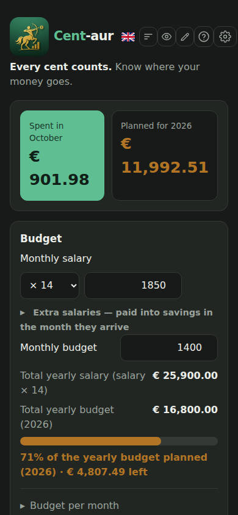
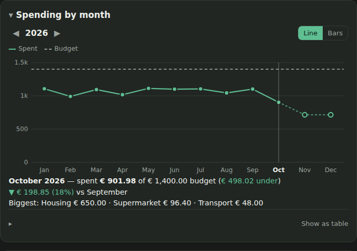
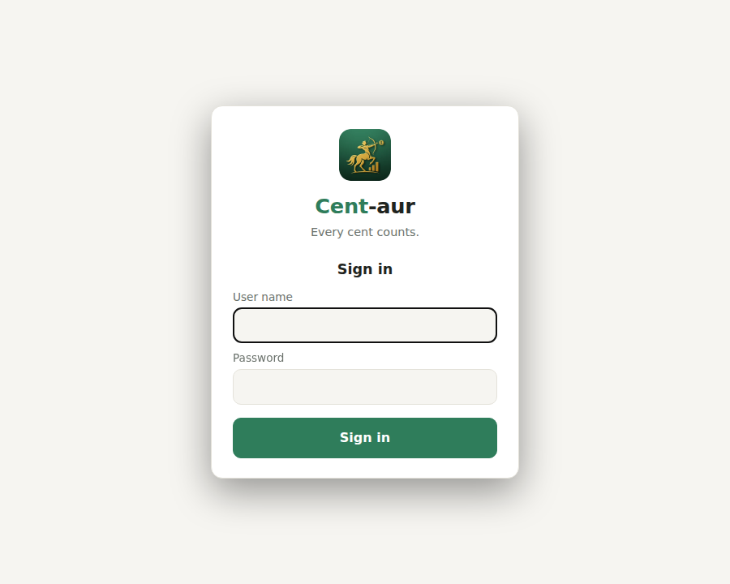
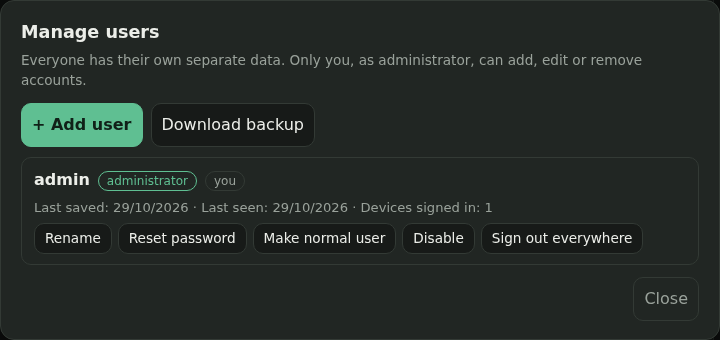

<p align="center">
  
</p>

<h1 align="center">Cent-aur</h1>

<p align="center"><b>Every cent counts.</b> Know where your money goes.</p>

<p align="center">
A self-hosted budget and expense tracker for a household, in English and Greek.<br>
One web page, one PHP file and one SQLite database: upload it to any PHP host and every person in the
family gets their own account, on their phone and on their computer.
</p>



## What it does

Cent-aur answers three questions at a glance: *how much have I spent this month, how much of my budget
is left, and which bills are still to pay?*

**Budget and savings**
- Set a monthly salary (× 12, × 14 or × 14.5, with the months the extra salaries arrive) and a monthly
  budget; whatever you don't spend counts as savings.
- A different budget for any single month, extra one-off money (a bonus, a sale, a gift) that goes to
  savings or to that month's budget, and withdrawals from savings.
- **Savings goals** with a target amount and date, showing how much to put aside each month.

**Expenses**
- One-time or repeating expenses (daily, weekly, every 2 weeks, monthly, quarterly, yearly) that can be
  paused, resumed or ended; past months never change.
- Categories with icons and groups, tags (`#work`, `#holiday`) and search by name, category or tag.
- **Merchant recognition:** start typing "Lidl", "Vodafone" or "ΔΕΗ" and Cent-aur suggests the name
  and picks the category, in Greek or Latin spelling, ignoring capitals and accents. Add your own
  merchants and logos.
- Duplicate detection before adding an expense that looks like one you already have.

**Bills and reminders**
- Mark categories as bills (electricity, water, mobile, internet, common charges…). If the next payment
  is not made a month after the last one, it is shown in red at the top until you pay it.
- A bills history that shows whether each bill went up or down.

**Seeing where the money goes**
- **Spending by month:** a year at a glance as a line or bar chart against your budget, with the
  biggest categories of any month.
- **By category** totals, **Insights** (for example "Housing is your biggest expense" or "your
  electricity bill is up 11%"), and **What if I cut back?** sliders that show the yearly saving of
  trimming a recurring expense.

**For freelancers** (optional tab)
- A separate book for work earnings and expenses, invoices pending until paid, a clients list, VAT
  per month or quarter and a printable monthly report for the accountant.
- A Greek freelancer tax calculator: income tax, EFKA contributions and the professional activity fee.

**Everything else**
- Accounts for the whole family, each with private data; an administrator adds and manages users and
  can download a backup of the whole database.
- English and Greek, light and dark appearance, six colour themes, a rearrangeable layout, a
  simple view, a floating calculator, and export / import / merge of your data as JSON.
- Works on phones and can be added to the home screen, and there is a **Windows app** that also works
  offline (see below).

| Phone | Spending by month |
|:-----:|:-----------------:|
|  |  |

| Sign in | Managing users |
|:-------:|:--------------:|
|  |  |

## Getting started

You need a web host with **Apache** (with `mod_rewrite`) and **PHP 7.4+** with `pdo_sqlite`, and
HTTPS. Upload the contents of [`public/`](public) to the site's web folder and open it:

1. Sign in as **`admin`** / **`admin`**.
2. Choose your own password (required before anything else works).
3. Add your family under **Your data → Account → Manage users**.

The database is created automatically in a `cent-aur-data` folder next to the web folder, out of reach
of the web. The full guide, including Cloudflare, backups and password recovery, is in
**[docs/SETUP.md](docs/SETUP.md)**.

### Try it locally

With Docker, from this folder:

```sh
docker run --rm -p 8080:80 -v "$PWD/public:/var/www/html" php:8.3-apache sh -c \
  'a2enmod -q rewrite headers && sed -i "s/AllowOverride None/AllowOverride All/" /etc/apache2/apache2.conf \
   && chown www-data /var/www && exec apache2-foreground'
```

Then open <http://localhost:8080> and sign in as `admin` / `admin`. The test database lives inside the
container and disappears when you stop it.

## Windows app

[`desktop/`](desktop) builds **`Cent-aur.exe`**, a single program for Windows 10 and 11 (about 12 MB,
nothing to install). It opens the same Cent-aur page in its own window and starts with a choice:

- **Sign in:** use your account on your Cent-aur server, exactly as on the website. The sign-in is
  remembered (encrypted for your Windows user), so the next start goes straight to your data.
- **Work offline on this PC:** no account and no internet needed; the data is kept in a SQLite
  database in `%APPDATA%\Cent-aur` on this PC only. **Options → Data folder** moves it (with the
  app's settings) to another folder, such as another drive, and back.

The two are kept apart, and you can switch from the account block in **Your data**. **Start with
Windows** is in the Options (the gear). Starting Cent-aur a second time brings the open window to the
front.

Build it with Docker (on Linux, macOS or Windows), giving the server the sign-in form should offer:

```sh
sh desktop/build.sh https://cent-aur.example.com
```

The result is `desktop/dist/Cent-aur.exe`. It needs Microsoft Edge WebView2, which is part of Windows
10 and 11. The program is not code-signed, so the first time Windows SmartScreen may say it is from an
unknown publisher (**More info → Run anyway**).

Inside, the app runs a small web server on `127.0.0.1` that only its own window can use (a random key
given to the window at start, and a check of the address it is reached by). Signed in, that server
passes the page's requests to your Cent-aur server; offline, it answers them itself with the same API
as `api.php`. The window is [WebView2](https://developer.microsoft.com/microsoft-edge/webview2/) through
[go-webview2](https://github.com/jchv/go-webview2); the database is the pure-Go
[modernc.org/sqlite](https://gitlab.com/cznic/sqlite).

## How it works

```
public/
├── index.html            the page: structure, help text (English and Greek) and its look (themes, light/dark, phone layout)
├── app.js                the program: plain JavaScript, no framework, no build step
├── api.php               the server: accounts and data, stored in SQLite
├── .htaccess             sends /api/... to api.php, security headers, caching
├── config.sample.php     optional settings (copy to config.php)
├── manifest.webmanifest  "Add to Home Screen" details
└── app-icons/            logo and icons

desktop/                  the Windows app (Go): window, local server, offline database, build.sh
```

- **No dependencies.** No framework, no package manager and no build step: the files in `public/`
  are exactly what the browser and PHP run.
- **One document per user.** After sign-in the page loads the user's data as one JSON document and
  saves it back after every change. Each save carries a revision number, so if another device saved in
  between, the server refuses with `409` and the page loads the latest version instead of
  overwriting it. Other devices' changes are picked up every 30 seconds and when the tab is reopened.
- **Online only.** Nothing is stored in the browser except the chosen colour theme (so the first
  screen already has the right colours). If the server can't be reached, the page says so and saves
  as soon as the connection returns.

### API

All endpoints are under `/api/` and use a session cookie. Requests that change something must send
`X-Requested-With: CentAur` and come from the same site.

| Method | Path | Purpose |
|--------|------|---------|
| `GET`  | `/api/session[?data=1]` | Who is signed in (`null` if nobody); with `data=1` also their data, as `/api/data` gives it, so the page needs one request to start |
| `POST` | `/api/login` | Sign in with `username` and `password` |
| `POST` | `/api/logout` | Sign out this browser |
| `POST` | `/api/password` | Change password (`old`, `new`) |
| `GET`  | `/api/data[?rev=N]` | The user's data and its revision (`{"same":true}` if unchanged) |
| `PUT`  | `/api/data` | Save `{rev, data}`; `409` if someone saved in between |
| `GET`  | `/api/admin/users` | List users (administrators only) |
| `POST` | `/api/admin/users` | Add a user |
| `PATCH`| `/api/admin/users/{id}` | Rename, reset password, change role, enable or disable |
| `DELETE`| `/api/admin/users/{id}` | Delete a user and their data |
| `POST` | `/api/admin/users/{id}/logout` | Sign a user out everywhere |
| `GET`  | `/api/admin/backup` | Download the whole database as one SQLite file |
| `GET`  | `/api/health` | Server version |

### Security

- Passwords are hashed with bcrypt (pre-hashed with SHA-256, so long passwords are not truncated);
  the default `admin` password must be changed at the first sign-in.
- Sessions are random tokens in `HttpOnly`, `SameSite=Lax` cookies (`Secure` over HTTPS); only their SHA-256
  hash is stored.
- Changes need a custom header and a same-site origin, which blocks cross-site requests.
- Wrong sign-ins are rate-limited per address and per user name; behind Cloudflare the real visitor
  address is only trusted from Cloudflare's own ranges.
- A Content-Security-Policy, `X-Frame-Options: DENY` and `nosniff` are sent for every page, and the
  database lives outside the web folder.

## Tests

[`tests/test_app.py`](tests/test_app.py) drives the real site in Chromium against Apache + PHP: first
sign-in with the default password, saving, two devices at once, edits clashing between devices, losing
the connection, managing users, the backup download, signing out, Greek, and checks that nothing is
hidden by ad blockers. Run it with Docker (nothing is installed on your computer):

```sh
sh tests/run-tests.sh            # the website
sh tests/run-desktop-tests.sh    # the Windows app's server: offline, signing in through it, restarts
```

The desktop tests run the app's own code (built for Linux, without the window) against a real
Cent-aur server, restarting it in between to check what it remembers. The window itself and the
Start with Windows registry entry can only be tried on Windows.

## Languages

The whole interface, the help and the server's messages are available in **English** and **Greek**
(Ελληνικά); the language follows the browser and can be changed from the top bar.
